<a href="https://github.com/prithvipm412?tab=repositories">all repos</a> ·
<a href="https://x.com/Prithvi_muclb">x</a> ·
<a href="https://instagram.com/areyouprithvi">instagram</a> ·
<a href="https://www.linkedin.com/in/YOUR-LINKEDIN/">linkedin</a>

auto-generated daily · last update <!--UPDATED-->2026-10-29<!--/UPDATED-->

